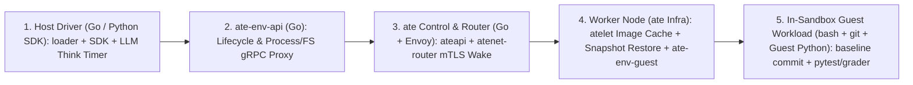

# Mixed R2E-Gym and SWE-bench Benchmark Report (`<run-id>`)

Copy this template to `$ARTIFACT_DIR/BENCHMARK_REPORT.md` after a run finishes (keep
`$ARTIFACT_DIR/report.md` and `$ARTIFACT_DIR/comparison.md` intact). Populate cluster, node, and
version tables from `system_description.json` (`bench measure -k8s`) and the pre-run checks in
[`../SKILL.md`](../SKILL.md), and populate results from `comparison.json`, `report.json`, and
`run_window.json`.

| Field                         | Value                                                                                                               | Source                                                 |
| :---------------------------- | :------------------------------------------------------------------------------------------------------------------ | :----------------------------------------------------- |
| **Run ID**                    | `<run-id>`                                                                                                          | `report.json` (`run`)                                  |
| **Date (UTC)**                | `<start_ts to end_ts>`                                                                                              | `run_window.json`                                      |
| **Duration**                  | `<wall_s> s`                                                                                                        | `report.json` (`run_ms`) or `comparison.json`          |
| **Cluster and zone**          | `<cluster-name>` (`<zone_topology>`)                                                                                | `system_description.json` (`cluster`, `zone_topology`) |
| **Kubernetes version**        | `<kubernetes_version>`                                                                                              | `system_description.json` (`kubernetes_version`)       |
| **`ate` (Substrate) version** | `<substrate_version>`                                                                                               | `system_description.json` (`substrate_version`)        |
| **`ate-env` version**         | `<git_sha>` (`api_image`, `guest_image`)                                                                            | `system_description.json` (`git_sha`, `sdk_version`)   |
| **Artifact bundle**           | `<$ARTIFACT_DIR or gs://<YOUR_BENCHMARK_BUCKET>/<YYYY-MM-DD>_<model-family>-<size>_<dataset>_<nickname>[_traced]/>` | Local path or `bench upload`                           |

## Headline Outcome & Time Attribution Summary

> [!IMPORTANT]
>
> - **What ran**:
>   `<prewarmer loader (swebench-loader plan-placement + preflight or bench prewarm) across <distinct_images> distinct images (<r2e_images> R2E-Gym + <swe_images> SWE-bench) x <sandbox_nodes> sandbox nodes (<golden + node-cache coverage, misses_per_first_cmd cold misses>) + <strategies tested, e.g. 4 pool strategies (none, naive, sliding, pipelined)> in swebench-loader / run_fleet_bench.py via the sandboxenv-rl SDK (--client <go | go-direct | python | all>) at concurrency=<max_concurrent> (<tasks> rollouts/arm, <rewarded>/<tasks> rewarded, <failed> failed)>`.
> - **Key numbers (`<reference-arm>`; drill-down in Sections `3.1`–`3.4`)**:
>   - **Wall clock**: `<arm_wall_s> s` (`<tasks_per_min>` tasks/min; `r2e=<r2e_wall_s> s`,
>     `swe=<swe_wall_s> s`; `<num_arms>`-arm sweep `<sweep_active_s> s` active / `<sweep_wall_s> s`
>     calendar wall, plus `<prewarm_wall_s> s` upfront prewarm).
>   - **Max concurrency observed**: `<active_sandboxes>` concurrent in-flight sandboxes
>     (`standing_pool=<n>`).
>   - **Infra fault rate (Trellis `<2.0%` M2 target)**: `<infra_fault_rate>%`
>     (`<infra_dropped>/<all_rollouts>` dropped rollouts: `tier1=<tier1_dropped>` before episode,
>     `tier3=<tier3_dropped>` during episode -> `<PASS | FAIL>`; `tier2=<tier2_policy>` policy
>     outcomes excluded; `<recovered_retries>` faults recovered by retry).
>   - **`TTFI` — `cmd started`** (sandbox requested -> container restored & 1st cmd started,
>     `p50 / p90`): `<ttfi_p50> / <ttfi_p90> ms`.
>   - **`TTFC` — `cmd complete`** (sandbox requested -> 1st cmd complete, `p50 / p90`):
>     `<ttfc_p50> / <ttfc_p90> ms` (`r2e=<r2e_ttfc_p50> ms`, `swe=<swe_ttfc_p50> ms`).
>   - **Time to restore (`p50 / p90`)**: `<restore_total_p50> / <restore_total_p90> ms` in `atelet`.
> - **Where time is actually spent (`<reference-arm>` `p50`)**:
>   - **Host Python SDK (`ate_env_rl`)**: `<py_sdk_ms> ms (<py_sdk_pct>%)` (`0 ms` when
>     `--client go` / `go-direct` drives the run; `python` minus `go` delta when `--client python`
>     runs).
>   - **Host SDK + `ate-env` + `ate` infrastructure**: `<ttfi_p50> ms` `TTFI` (`cmd started`)
>     startup (`<restore_total_p50> ms` `atelet` restore + `<wake_route_p50> ms` demand-wake
>     routing), totaling `~<r2e_infra_ms>–<swe_infra_ms> ms (<r2e_infra_pct>%–<swe_infra_pct>%)`
>     across an entire rollout.
>   - **Simulated LLM think (`Step.Think`)**: `<r2e_think_ms> ms (<r2e_think_pct>%)` on `r2e` and
>     `<swe_think_ms> ms (<swe_think_pct>%)` on `swe` (`custom_metrics.llm_think_ms`).
>   - **In-sandbox guest workload (`bash`/`git` + container `Python` `pytest` & graders)**:
>     `~<r2e_guest_ms> ms (<r2e_guest_pct>%)` on `r2e` and `~<swe_guest_ms> ms (<swe_guest_pct>%)`
>     on `swe`.
> - **Strategy and client takeaway**:
>   `<1-2 sentences comparing tested strategies (wall-clock vs standing-pool reduction and window-drain barriers) and Go / Go-direct / Python chains, plus dominant_bottleneck>`.



Populate the grouped bar histograms below with one `bar [...]` series per arm in table row order
(for example left-to-right: `none`, `naive`, `sliding`, `pipelined`) and adjust each `y-axis` max to
fit your run:

```mermaid
xychart-beta
  title "Startup & Sandbox Lifecycle by Test Strategy / Category (ms — left-to-right: none, naive, sliding, pipelined)"
  x-axis "Test Strategy / Category" ["In-Band Claim p50", "Upfront Prewarm p50", "atelet Restore p50", "TTFI cmd started p50", "TTFI cmd started p90", "Delete p50"]
  y-axis "Time (ms)" 0 --> 300
  bar [0, 0, 0, 0, 0, 0]
  bar [0, 0, 0, 0, 0, 0]
  bar [0, 0, 0, 0, 0, 0]
  bar [0, 0, 0, 0, 0, 0]
```

```mermaid
xychart-beta
  title "TTFC — 1st Cmd Complete by Test Strategy / Category (ms — left-to-right: none, naive, sliding, pipelined)"
  x-axis "Test Strategy / Category" ["TTFC r2e p50", "TTFC All p50", "TTFC swe p50", "TTFC All p95"]
  y-axis "Time (ms)" 0 --> 4500
  bar [0, 0, 0, 0]
  bar [0, 0, 0, 0]
  bar [0, 0, 0, 0]
  bar [0, 0, 0, 0]
```

```mermaid
xychart-beta
  title "Shard & Arm Wall Clock by Test Strategy / Category (s — left-to-right: none, naive, sliding, pipelined)"
  x-axis "Test Strategy / Category" ["r2e Shard Wall (s)", "swe Shard / Arm Wall (s)"]
  y-axis "Time (s)" 0 --> 400
  bar [0, 0]
  bar [0, 0]
  bar [0, 0]
  bar [0, 0]
```







## 1. Cluster, node, and version specification

### 1.1 Cluster spec

| Field                     | Value                                                                                               |
| :------------------------ | :-------------------------------------------------------------------------------------------------- |
| **Platform and K8s**      | `<GKE / K8s version>`, node image / kernel `<os_kernel>`, `<storage_driver_and_fs>`                 |
| **Zones and networking**  | `<zone_topology>`, `<private/public nodes, Cloud NAT egress, VPC>`                                  |
| **Registry and bucket**   | Image registry in `<region>`, snapshots bucket in `<bucket_region>`                                 |
| **Telemetry**             | `-enable-tracing=<bool>`, OTel collector `<on/off>`, `SAMPLE_CACHE=<0/1>`, `HARVEST_RESTORES=<0/1>` |
| **CPU family uniformity** | `<single CPU family (<platform>) \| mixed families (note in Caveats)>`                              |

### 1.2 Node pool spec

| Node pool       | Machine type and CPU family      | vCPU / RAM     |   Nodes | Boot disk type and size | Role                                        | Labels and taints                     |
| :-------------- | :------------------------------- | :------------- | ------: | :---------------------- | :------------------------------------------ | :------------------------------------ |
| `<worker-pool>` | `<e.g. n2-standard-32, Cascade>` | `<vcpu / gib>` | `<cnt>` | `<e.g. 500 GB pd-ssd>`  | Sandbox nodes (`atelet` + `ateworker` pods) | `<labels / runtime NoSchedule taint>` |
| `<ctrl-pool>`   | `<e.g. e2-standard-16>`          | `<vcpu / gib>` | `<cnt>` | `<e.g. 200 GB pd-ssd>`  | `ate` control plane + `ate-env-api`         | `<control-plane taint>`               |
| `<db-pool>`     | `<e.g. n2-standard-16>`          | `<vcpu / gib>` | `<cnt>` | `<disk + PVC>`          | Bundled Postgres                            | `<postgres taint>`                    |
| `<driver-pool>` | `<e.g. e2-standard-32>`          | `<vcpu / gib>` | `<cnt>` | `<disk>`                | Benchmark loader `Job` (when `in-cluster`)  | `<labels / taints>`                   |

### 1.3 `ate` (Substrate) and `ate-env` versions and settings

| Component                | Version / image digest     | Replicas / count                  | Key settings                                                                               |
| :----------------------- | :------------------------- | :-------------------------------- | :----------------------------------------------------------------------------------------- |
| `ate-api-server`         | `<substrate_version>`      | `<replicas>`                      | `ATE_API_POSTGRES_POOL_MAX_CONNS=<N>`                                                      |
| `atenet-router`          | `<substrate_version>`      | `<replicas>`                      | `<default or overrides>`                                                                   |
| `atelet` (`DaemonSet`)   | `<substrate_version>`      | `<sandbox_nodes>`                 | `--image-cache-gc-period=<d> --image-cache-high-percent=<h> --image-cache-low-percent=<l>` |
| `WorkerPool`             | `<ateworker image@sha256>` | `<worker_pod_count>` (`<k>`/node) | `<pool_name>`, `worker_actor_capacity=<N>`, `max_concurrent_sandboxes_cap=<M>`             |
| `SandboxConfig`          | `<runtime_class>`          | `<config_name>`                   | `<gvisor or microvm>`                                                                      |
| Base `ActorTemplate`     | `<guest_image@sha256>`     | `1` (`<base_template>`)           | `<cpu>` vCPU / `<memory_gib>` GiB / `<disk_gib>` GiB, golden snapshots `<on/off>`          |
| Derived `ActorTemplate`s | `<base_template>-<12hex>`  | `<derived_count>`                 | `<N/N goldenTags ready before t0>`                                                         |
| `ate-env-api`            | `<api_image@sha256>`       | `<replicas>`                      | Service `<api_service>`, `-wake-budget=<d>`, `-wake-running-budget=<d>`                    |
| `ate-env` SDK / loader   | `<sandboxenv-rl git_sha>`  | `<connections>` gRPC channels     | Go `clients/go`, Python `ate_env_rl`, `--execution <in-cluster \| local>`                  |

## 2. Concurrency and workload parameters

| Parameter                   | Value                                                         | Source / flag                                                                          |
| :-------------------------- | :------------------------------------------------------------ | :------------------------------------------------------------------------------------- |
| **Configured concurrency**  | `<max_concurrent>` total (`r2e=<w1>`, `swe=<w2>`, `<k>`/node) | `--concurrency`, `--r2e-width`, `--swe-width`                                          |
| **Observed pool footprint** | `peak_active=<n>`, `standing_pool=<n>`, `peak_parked=<n>`     | `report.json` (`peak_active_sandboxes`, `standing_pool_size`, `peak_parked_sandboxes`) |
| **Distinct images**         | `<total>` (`<r2e>` R2E-Gym + `<swe>` SWE-bench, `<exclude>`)  | `--images`, `distinct_images`, `labels.exclude_file`                                   |
| **Rollouts per image**      | `<rollouts>` (`steps=<steps>`, `mode=<mode>`, `park=<park>`)  | `--rollouts-per-image`, `--steps`, `--mode`, `--park`                                  |
| **Total tasks**             | `<tasks>` (`r2e=<r2e_tasks>`, `swe=<swe_tasks>`)              | `report.json` (`tasks`, `jobs`)                                                        |
| **Strategies and window**   | `<none \| naive \| sliding \| pipelined \| all>` (`win=<w>`)  | `--strategy`, `--window-size`                                                          |
| **Client chains**           | `<go \| go-direct \| python \| all>`                          | `--client`                                                                             |
| **Workload trajectory**     | `<graded (r2e-gold + swebench-gold) \| io>`                   | `--workload`, `labels.trajectory`                                                      |

## 3. Results

### 3.1 Strategy multi-arm comparison

Populate from `$ARTIFACT_DIR/comparison.json` / `comparison.md`, per-arm `report.json`, and
`{r2e,swe}-summary.json` (matching the grouped bar histograms in
`## Headline Outcome & Time Attribution Summary`). `Wall (s)` is in **seconds (`s`)**; every latency
column is `p50/p95/p99` (or `p50` where noted) in **milliseconds (`ms`)**:

- **`Wall` (`s`: arm [`r2e` / `swe`])**: Concurrent arm wall clock (`report.json` `run_ms / 1000` =
  `max(r2e, swe)`), followed by per-shard `r2e` and `swe` wall clock from `{r2e,swe}-summary.json`.
- **`Handle claim` (`ms`)**: Sandbox requested -> `SUSPENDED` actor handle returned
  (`wire_claim_to_ready_*` on `none`; `0` at rollout start on warm-pool hits after upfront
  `Create` + `Suspend` prewarm; container has not booted yet).
- **`TTFI` — `cmd started` (`p50/p90/p95 ms`)**: Sandbox requested -> container restored and 1st
  command started inside the guest (join `events/*.jsonl` `ttfi`/`wake` start `ts - dur_ms` to
  `atelet_restores.jsonl` `time`, or sum `handle_claim` + demand-wake routing + `atelet` `total`
  restore).
- **`Infra fault` (`< <target_pct>%`, from `fault_classification.target_rate`)**: Share of rollouts
  dropped due to Tier 1 (before episode:
  `create_timeout`, `no_capacity`, `image_pull_unpack`, `transport_error`, `other`) or Tier 3
  (during episode: `wake_resume_failure`, `sandbox_crash`, `snapshot_restore_failure`,
  `eviction_preemption`, `other`) infrastructure faults out of `all_rollouts` (`report.json`
  `fault_classification.infra_fault_rate` vs `< 2.0%` Trellis M2 target). Excludes Tier 2 policy
  failures and faults recovered by retry. An `other` row is an infrastructure error no matcher
  named yet: quote its `example_err` in the findings.
- **`TTFC` — `cmd complete` (`ms`)**: Sandbox requested -> 1st command complete
  (`stats[event="ttfi"]` on `none` or `stats[event="wake"]` on warm-pool strategies, including
  `step=baseline` execution inside the sandbox).

| Arm     | Client     | Strategy     |       Active / Pool | Tasks (fail) | Infra fault (`< <target_pct>%`)    |   Reward | Wall (`s`: arm [`r2e`/`swe`]) | Tasks/min | Warm hit | Prewarm `Create` (`ms`) | Prewarm `Suspend` (`ms`) | `Handle` claim (`ms`) | `TTFI` — `cmd started` (`p50/p90/p95 ms`) | `TTFC` — `cmd complete` (`ms`) | `TTFC` — `cmd complete` (`p50 ms`: `r2e` / `swe`) |     `Delete` (`ms`) |
| :------ | :--------- | :----------- | ------------------: | -----------: | :--------------------------------- | -------: | ----------------------------: | --------: | -------: | ----------------------: | -----------------------: | --------------------: | ----------------------------------------: | -----------------------------: | ------------------------------------------------: | ------------------: |
| `<arm>` | `<client>` | `<strategy>` | `<active> / <pool>` |  `<n> (<f>)` | `<pct>% (<PASS\|FAIL>, <d>/<a>)`   | `<rate>` |     `<sec> (<r2e_s>/<swe_s>)` |   `<tpm>` | `<pct>%` |     `<p50>/<p95>/<p99>` |      `<p50>/<p95>/<p99>` |   `<p50>/<p95>/<p99>` |                       `<p50>/<p90>/<p95>` |            `<p50>/<p95>/<p99>` |                             `<r2e_p50>/<swe_p50>` | `<p50>/<p95>/<p99>` |

### 3.2 Where time is spent: layer attribution (`Go` vs `Python` vs `ate` infra vs guest workload)

Decompose latencies by execution layer so host SDK (`Go` `clients/go` vs `Python` `ate_env_rl`),
`ate-env` / `ate` infrastructure, simulated LLM think pauses, and in-sandbox guest commands (`bash`
/ `git` / container `Python` `pytest`) are never conflated. Anchor single-RPC data-plane wire hop on
zero-compute `write_*` steps (`stats[event="step", name="write_patch"]`) or OTel spans.

#### A. First-command (`TTFC` — `cmd complete`) decomposition (`p50 ms`)

| Execution layer                            | Runtime / component                           | What happens                                                            | `<cold/none> r2e` (`ms`) | `<cold/none> swe` (`ms`) | `<warm/ref> r2e` (`ms`) | `<warm/ref> swe` (`ms`) | Share of `TTFC` |
| :----------------------------------------- | :-------------------------------------------- | :---------------------------------------------------------------------- | -----------------------: | -----------------------: | ----------------------: | ----------------------: | --------------: |
| **Host Python SDK**                        | Host `Python` (`ate_env_rl`)                  | `0.0` on `--client go`/`go-direct`; `python` minus `go` delta if run    |                   `<ms>` |                   `<ms>` |                  `<ms>` |                  `<ms>` |        `<pct>%` |
| **Host client queue**                      | Host `Go` / `Python` driver                   | Concurrency slot wait (`custom_metrics.sdk_slot_wait_ms`)               |                   `<ms>` |                   `<ms>` |                  `<ms>` |                  `<ms>` |        `<pct>%` |
| **Control-plane handle claim**             | Client -> `ate-env-api` -> `ateapi`           | `CreateActor` `SUSPENDED` handle (`0.0` in-band on warm-pool hits)      |                   `<ms>` |                   `<ms>` |                  `<ms>` |                  `<ms>` |        `<pct>%` |
| **Node image cache check**                 | `atelet` (`Go` node daemon)                   | `manifest_fetch` + `download` + `oci_unpack` (`restores.*.phases`)      |                   `<ms>` |                   `<ms>` |                  `<ms>` |                  `<ms>` |        `<pct>%` |
| **Sandbox snapshot restore**               | `atelet` + `ateworker` (`ate` infra)          | Restore container rootfs + memory (`worker_restore` + `sandbox_assets`) |                   `<ms>` |                   `<ms>` |                  `<ms>` |                  `<ms>` |        `<pct>%` |
| **Demand-wake routing & proxy**            | Client -> `ate-env-api` -> `atenet` -> `ate`  | `atenet` mTLS wake trigger + `ResumeActor` + gRPC hop                   |                   `<ms>` |                   `<ms>` |                  `<ms>` |                  `<ms>` |        `<pct>%` |
| **Subtotal — `TTFI` (`cmd started`)**      | **Host SDK + `ate-env` + `ate` infra**        | **Sandbox restored, routed, and 1st cmd started in guest**              |               **`<ms>`** |               **`<ms>`** |              **`<ms>`** |              **`<ms>`** |    **`<pct>%`** |
| **In-sandbox 1st cmd (`baseline`)**        | **Guest `bash` / `git` / container `Python`** | `outside` minus gRPC wire (`git add -A && git commit` / `.venv` prep)   |                   `<ms>` |                   `<ms>` |                  `<ms>` |                  `<ms>` |        `<pct>%` |
| **Total — `TTFC` (`cmd complete`, `p50`)** | **End-to-end measured**                       | **`stats[event="ttfi"]` or `stats[event="wake"]` (1st cmd complete)**   |               **`<ms>`** |               **`<ms>`** |              **`<ms>`** |              **`<ms>`** |      **`100%`** |

#### B. Full single-rollout (`task`) time budget (`<reference-arm>` `p50`)

| Execution layer                               | Runtime                      | Operations included                                                          | `r2e` rollout (`p50 ms` / `%`) | `swe` rollout (`p50 ms` / `%`) |
| :-------------------------------------------- | :--------------------------- | :--------------------------------------------------------------------------- | -----------------------------: | -----------------------------: |
| **1. Host Python SDK**                        | Host `Python` (`ate_env_rl`) | `0 ms` on `--client go`; client overhead delta when `--client python` is run |             `<ms> ms (<pct>%)` |             `<ms> ms (<pct>%)` |
| **2. Host client + `ate-env-api` + `atenet`** | `Go` + `Envoy`               | Per-step gRPC `WriteFile` + `StartProcess` wire hops across trajectory steps |             `<ms> ms (<pct>%)` |             `<ms> ms (<pct>%)` |
| **3. `ate` node restore infra (in-rollout)**  | `atelet` + runtime           | Node cache check + snapshot/checkpoint restore (`restores.*.phases[total]`)  |             `<ms> ms (<pct>%)` |             `<ms> ms (<pct>%)` |
| **4. Simulated LLM think pause**              | Host loader timer            | Intentional `Step.Think` sleep (`custom_metrics.llm_think_ms`)               |             `<ms> ms (<pct>%)` |             `<ms> ms (<pct>%)` |
| **5. In-sandbox shell / `git` commands**      | Guest `bash` / `git`         | `baseline`, `explore`, `read_files`, `apply_patch` (net of gRPC wire)        |             `<ms> ms (<pct>%)` |             `<ms> ms (<pct>%)` |
| **6. In-sandbox test suite & grader**         | **Guest `Python`**           | Container `.venv` / conda `pytest` (`run_tests`) + JSON grader (`grade`)     |             `<ms> ms (<pct>%)` |             `<ms> ms (<pct>%)` |
| **Total in-rollout span (`task` `p50`)**      | **All layers**               | **Rollout start -> reward verdict (`stats[event="task"]`)**                  |           **`<ms> ms (100%)`** |           **`<ms> ms (100%)`** |
| _Out-of-band pool lifecycle_                  | Host SDK + `ate` infra       | Upfront `create` + `suspend` + post-rollout `delete` outside `task` span     |        `+<ms> ms outside task` |        `+<ms> ms outside task` |

#### C. End-to-end arm and sweep wall-clock (`Wall (s)`) breakdown

| Arm / phase               | Arm wall (`s`) | `r2e` / `swe` shard wall (`s`) | Upfront pool prewarm (`s`) | Ideal slot-busy work (`sum(task)/width`, `s`) | Straggler / window-barrier idle (`s`) | Post-rollout teardown (`s`) |
| :------------------------ | -------------: | -----------------------------: | -------------------------: | --------------------------------------------: | ------------------------------------: | --------------------------: |
| `<arm>`                   |        `<sec>` |            `<r2e_s> / <swe_s>` |                    `<sec>` |                           `<r2e_s> / <swe_s>` |                   `<r2e_s> / <swe_s>` |                     `<sec>` |
| _Upfront prewarm_         |        `<sec>` |                            `-` |     `<plan + prewarm sec>` |                                           `-` |                                   `-` |                         `-` |
| _Sweep total (`<N>` arm)_ |        `<sec>` |      `<active_s> / <cal_wall>` |     `<inter-arm overhead>` |                                           `-` |                                   `-` |                         `-` |

### 3.3 Raw sandbox lifecycle and command latencies (`<reference-arm>`)

Populate from `$ARTIFACT_DIR/[arms/<arm>/]report.json` (`stats[]`, `headline_baseline`,
`custom_metrics`), plus OTel `spans.jsonl` when `-enable-tracing` is enabled. Write `-` when an
operation does not occur in the selected strategy (for example `ttfc` on `100%` warm strategies or
`wake` on `none`).

| Metric                   | Span measured                                             | Bundle source                                                      | Count | Failed | p50 (ms) | p90 (ms) | p95 (ms) | p99 (ms) | Max (ms) |
| :----------------------- | :-------------------------------------------------------- | :----------------------------------------------------------------- | ----: | -----: | -------: | -------: | -------: | -------: | -------: |
| `sdk_slot_wait`          | Concurrency slot wait before wire claim                   | `custom_metrics.sdk_slot_wait_ms` / `headline_baseline`            | `<n>` |    `-` |  `<p50>` |  `<p90>` |  `<p95>` |  `<p99>` |  `<max>` |
| `actor_create`           | Substrate `ateapi` `CreateActor` RPC                      | `stats[create]` on `go-direct`, or OTel `CreateActor` span         | `<n>` |  `<f>` |  `<p50>` |  `<p90>` |  `<p95>` |  `<p99>` |  `<max>` |
| `sandbox_create`         | `CreateEnvironment` / SDK sandbox claim                   | `stats[event="create"]`                                            | `<n>` |  `<f>` |  `<p50>` |  `<p90>` |  `<p95>` |  `<p99>` |  `<max>` |
| `prewarm`                | Warm-pool sandbox create + suspend                        | `stats[event="prewarm"]` or summed `create + suspend`              | `<n>` |  `<f>` |  `<p50>` |  `<p90>` |  `<p95>` |  `<p99>` |  `<max>` |
| `handle_claim`           | Sandbox requested -> `SUSPENDED` handle returned          | `custom_metrics.wire_claim_to_ready_ms` (`0` on warm-pool hit)     | `<n>` |    `-` |  `<p50>` |  `<p90>` |  `<p95>` |  `<p99>` |  `<max>` |
| `ttfi` (`cmd started`)   | Sandbox requested -> container restored & 1st cmd started | `events/*.jsonl` (`ts - dur_ms`) -> `atelet_restores.jsonl` `time` | `<n>` |    `-` |  `<p50>` |  `<p90>` |  `<p95>` |  `<p99>` |  `<max>` |
| `first_cmd_exec`         | First command issued -> first command complete            | `custom_metrics.ready_to_first_cmd_ms` / `stats[step/baseline]`    | `<n>` |  `<f>` |  `<p50>` |  `<p90>` |  `<p95>` |  `<p99>` |  `<max>` |
| `ttfc` (`cmd complete`)  | Sandbox requested -> first command complete               | `stats[event="ttfi"]`                                              | `<n>` |  `<f>` |  `<p50>` |  `<p90>` |  `<p95>` |  `<p99>` |  `<max>` |
| `suspend`                | `SuspendEnvironment` checkpoint                           | `stats[event="suspend"]`                                           | `<n>` |  `<f>` |  `<p50>` |  `<p90>` |  `<p95>` |  `<p99>` |  `<max>` |
| `wake` (`cmd complete`)  | First command on parked sandbox (issue -> complete)       | `stats[event="wake"]`                                              | `<n>` |  `<f>` |  `<p50>` |  `<p90>` |  `<p95>` |  `<p99>` |  `<max>` |
| `step` (`explore`)       | In-sandbox repository exploration command                 | `stats[event="step", name="explore"]`                              | `<n>` |  `<f>` |  `<p50>` |  `<p90>` |  `<p95>` |  `<p99>` |  `<max>` |
| `step` (`read_files`)    | In-sandbox file reads                                     | `stats[event="step", name="read_files"]`                           | `<n>` |  `<f>` |  `<p50>` |  `<p90>` |  `<p95>` |  `<p99>` |  `<max>` |
| `step` (`apply_patch`)   | Gold patch write + `git apply`                            | `stats[event="step", name="apply_patch"]`                          | `<n>` |  `<f>` |  `<p50>` |  `<p90>` |  `<p95>` |  `<p99>` |  `<max>` |
| `step` (`run_tests`)     | Evaluation `pytest` suite execution                       | `stats[event="step", name="run_tests"]`                            | `<n>` |  `<f>` |  `<p50>` |  `<p90>` |  `<p95>` |  `<p99>` |  `<max>` |
| `step` (`grade`)         | Test output grading                                       | `stats[event="step", name="grade"]`                                | `<n>` |  `<f>` |  `<p50>` |  `<p90>` |  `<p95>` |  `<p99>` |  `<max>` |
| `task` (`r2e-gold`)      | End-to-end R2E-Gym rollout                                | `stats[event="task", name="r2e-gold"]`                             | `<n>` |  `<f>` |  `<p50>` |  `<p90>` |  `<p95>` |  `<p99>` |  `<max>` |
| `task` (`swebench-gold`) | End-to-end SWE-bench rollout                              | `stats[event="task", name="swebench-gold"]`                        | `<n>` |  `<f>` |  `<p50>` |  `<p90>` |  `<p95>` |  `<p99>` |  `<max>` |
| `delete`                 | `DeleteEnvironment` / `DeleteActor`                       | `stats[event="delete"]`                                            | `<n>` |  `<f>` |  `<p50>` |  `<p90>` |  `<p95>` |  `<p99>` |  `<max>` |
| `step_barrier`           | First rollout start -> last rollout finish in step        | `stats[event="step_barrier"]`                                      | `<n>` |  `<f>` |  `<p50>` |  `<p90>` |  `<p95>` |  `<p99>` |  `<max>` |
| `run` (wall clock)       | Per-shard benchmark wall clock (`r2e` / `swe`)            | `stats[event="run"]` / `{r2e,swe}-summary.json` (`run_ms`)         | `<n>` |  `<f>` |  `<p50>` |  `<p90>` |  `<p95>` |  `<p99>` |  `<max>` |

### 3.4 Step barrier, shard split, and optional node telemetry

| Step |  Live | Tasks | Wall (`s`: arm [`r2e`/`swe`]) | Barrier (ms) | Park (ms) | Rollout p50 / p99 / p100 (ms) | Skew (`p100/p50`) | LLM think (ms) | Env wait (ms) | Env overhead (%) |
| ---: | ----: | ----: | ----------------------------: | -----------: | --------: | ----------------------------: | ----------------: | -------------: | ------------: | ---------------: |
|  `1` | `<n>` | `<n>` |     `<sec> (<r2e_s>/<swe_s>)` |  `<barrier>` |  `<park>` |      `<p50> / <p99> / <p100>` |         `<skew>x` |   `<think_ms>` |   `<wait_ms>` |         `<pct>%` |

- **Shard split and contention**: `job=r2e` `<r2e_rewarded>/<r2e_tasks>` (`reward_rate=<rate>`),
  `job=swe` `<swe_rewarded>/<swe_tasks>` (`reward_rate=<rate>`), `slot_wait_p95_ms=<p95>`, dominant
  bottleneck `<rl_step_breakdown.dominant_bottleneck>`.
- **Node cache and `atelet` restore sub-phases** (when `SAMPLE_CACHE=1` or `HARVEST_RESTORES=1`
  ran): `<cache.misses_per_first_cmd>` misses/start, `restores.{first,wakes}.phases[]`
  (`p50/p90/p95`: `manifest_fetch=<p50>/<p90>/<p95>`, `download=<p50>/<p90>/<p95>`,
  `oci_unpack=<p50>/<p90>/<p95>`, `worker_restore=<p50>/<p90>/<p95>`, `total=<p50>/<p90>/<p95>`),
  and `outside=<p50>/<p90>/<p95>` ms.

## 4. Failures, findings, and caveats

Populate directly from `report.json` `fault_classification` (and `jobs.{r2e,swe}.fault_classification`
for per-shard attribution; Trellis and M2 are defined in
[docs/glossary.md](../../../docs/glossary.md)). `infra_fault_rate = (tier1_dropped + tier3_dropped) / all_rollouts`
excludes Tier 2 policy outcomes (`nonzero_exit`, `command_timeout`, `guest_oom`) and transient
faults recovered by retry (`recovered_retries`):

- **Trellis M2 reliability check (`< 2.0%` `infra_fault_rate`)**: `<arm>: <infra_fault_rate>%`
  (`<infra_dropped>/<all_rollouts>` dropped: `tier1=<tier1_dropped>`, `tier3=<tier3_dropped>` ->
  `<PASS | FAIL>`; `tier2_policy=<tier2_policy>`, `recovered_retries=<recovered_retries>`).

| Arm     | Tier                                                                                                    | Category     | Dropped rollouts | Recovered by retry | Events | Example error          |
| :------ | :------------------------------------------------------------------------------------------------------ | :----------- | ---------------: | -----------------: | -----: | :--------------------- |
| `<arm>` | `<Tier 1 (before episode, infra) \| Tier 2 (during episode, policy) \| Tier 3 (during episode, infra)>` | `<category>` |            `<n>` |              `<n>` |  `<n>` | `<example_err or "-">` |

- **Findings**:
  `<2-3 bullets on strategy wall-clock vs standing-pool trade-off and Go vs Go-direct vs Python overhead>`.
- **Caveats**:
  `<cluster or execution caveats affecting comparisons, such as local port-forward RTT, mixed node CPU families, or uncollected OTel spans for actor_create>`.

## 5. Exact commands executed

Record the verbatim prewarm, benchmark execution, telemetry harvest, and cleanup commands that
produced this bundle:

```bash
# 1. Upfront placement plan + golden & node-cache prewarm (if run)
<exact swebench-loader plan-placement + preflight or bench prewarm commands>

# 2. Mixed R2E-Gym + SWE-bench benchmark execution
<exact run-r2e-swebench.sh or swebench-loader / run_fleet_bench.py command>

# 3. Cluster snapshot / report / teardown commands (if run)
<exact bench measure -k8s, sample-node-cache.sh, or cleanup commands>
```
