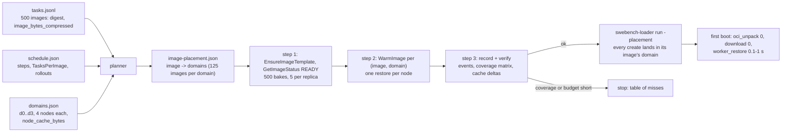
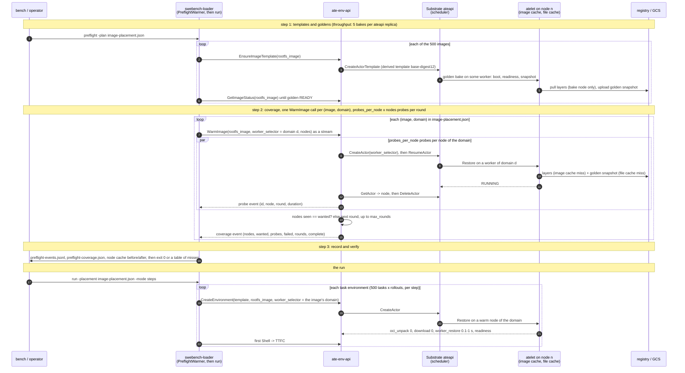

# PreflightWarmer: place task images across nodes before an RL job

Draft 2026-11-02, status as of 2026-11-09 (rows 1, 2, 3, 4a, 4b, 5, 7 and 10 are on main; the
thin-client rewrite, the fleet flag and the measurement are not; the 2026-11-09 audit added rows 13
to 25). First consumer: `swebench-loader` (the Fast rung of the RL benchmark ladder). The component
is the `PreflightWarmer`, the sibling of the fleet's `LookaheadWarmer`: that one keeps instances
ready, this one keeps node caches ready. Substrate facts below are from `agent-substrate/substrate`
main `24482d5d` (2026-11-02); sandboxenv-rl builds against `274605f1` since #254 (2026-11-08), and
the facts were not re-checked against it.

## Goal

Before a job starts, every task image the dataset needs is already unpacked in the image cache of
the nodes that will run it, and its golden snapshot is already in those nodes' file caches, so the
**first boot of an environment from that image** skips the pull, the unpack and the snapshot
download. The job then measures and trains on warm nodes from its first step, and the "first boot"
cost stops depending on where the scheduler happened to put the actor.

Non-goals for the first version: wake latency of suspended environments between episodes (already
pinned to the node with the local snapshot; the slow case is the detach to a full node, Substrate
issue #3482); Harbor, OpenHands and NeMo Gym jobs (they get the same machinery through the Python
fleet in a later phase); changing Substrate's scheduler (asks are listed at the end).

## What a first boot costs today

A `CreateEnvironment` with `rootfs_image` derives the template `<base>-<digest12>` once per image
and creates the actor; Substrate bakes a golden snapshot for the template in the background, 5 at a
time per ateapi replica, about two minutes each (`benchmarking/swebench/SKILL.md`, check 3 of "Check
the cluster before the first run"). The actor restores from the golden tag snapshot (or cold-boots
while the bake runs) on whichever eligible worker the scheduler picks. The restore timing breakdown
atelet logs per actor (`benchmarking/swebench/harvest-restore-timings.sh`, phases
`volume_mount, manifest_fetch, sandbox_assets, download, oci_unpack, worker_restore, persist, total`)
shows where the time goes on a cold node: `oci_unpack` (image layers not in the node's image cache;
~28 s for the images in Substrate issue #3482, minutes for the 9 GB images in sandboxenv-rl #200)
and `download` (the shared tag snapshot not yet in the node's file cache).

Placement is image-blind: "16 rollouts of one image land on 13 to 16 nodes"
(`benchmarking/swebench/SKILL.md`, "Read the report"); "a restore lands on whichever node has room;
if that node has never pulled the image, the restore pulls it first"
(`benchmarking/swebench/README.md`, "Cold boot, cold and warm restore, suspend and wake"). Nothing
in sandboxenv-rl knows which node holds which image. Since #207 (merged) `ate-env-api` reports the
node an environment ran on (`Environment.node`); `benchmarking/swebench/README.md` ("Image-delivery
workloads") predates it and still says the report cannot tell.

## Where TTFC goes, and what removes each part

Time to first command for a new environment of image X, in the order it is paid, with the lever for
each. PreflightWarmer is lever 3; it is the strongest client-side lever available on Substrate main,
not the whole answer.

| #   | Cost                                                                      | Size                                                                                                                                                                                                                                                                                                                                                                                | Lever                                                                                                                                                                     | Where                                                                           |
| --- | ------------------------------------------------------------------------- | ----------------------------------------------------------------------------------------------------------------------------------------------------------------------------------------------------------------------------------------------------------------------------------------------------------------------------------------------------------------------------------- | ------------------------------------------------------------------------------------------------------------------------------------------------------------------------- | ------------------------------------------------------------------------------- |
| 1   | No golden yet: cold boot (container start + guest start + wakeup probe)   | 30–60 s on dense nodes (sandboxenv-rl #139)                                                                                                                                                                                                                                                                                                                                         | bake every golden before the run; bake throughput is 5 per ateapi replica. A golden saves the boot only on a node that already holds the layers (substrate#3481)          | PreflightWarmer step 1; substrate#3484                                          |
| 2   | First boot on the job's critical path at all                              | whatever 3–5 add up to                                                                                                                                                                                                                                                                                                                                                              | pre-create the working set as suspended environments ahead of the step (`LookaheadWarmer`, `-prefetch`), so the trainer sees a wake (~0.2–1 s pinned) not a boot          | fleet SDK, loader; PreflightWarmer makes those creates cheap and the tail short |
| 3   | `oci_unpack`: layers not in the node's image cache                        | 1 ms with the layers on the node, 9–50 s without, 300 s under contention; ~97 % of a cold first command (substrate#3481)                                                                                                                                                                                                                                                            | put the layers on the nodes first (PreflightWarmer); upstream: image-aware placement (#298), lazy layers (EROFS, #2609), dedup of shared base layers already in the cache | this plan                                                                       |
| 4   | `download`: golden snapshot not in the node's file cache                  | snapshot size / GCS throughput                                                                                                                                                                                                                                                                                                                                                      | same pass fills it (shared tag snapshots are node-cached); upstream: hard links instead of copies (#2948)                                                                 | this plan                                                                       |
| 5   | `worker_restore`: memory restore of the golden                            | 0.1–1 s; a boot if the CPU family differs                                                                                                                                                                                                                                                                                                                                           | one CPU family per domain; small guest memory; MEMORY fidelity                                                                                                            | domains                                                                         |
| 6   | Wake moved to a cold node because the pinned node was full                | 35.3 % of 143,954 wakes across 36,841 images landed on a node without the image and paid 77 s p50 on pd-balanced (2026-11-04 run `2026-11-04_simulated_prime-swe-rl_36k-parked`); the same 35 % on 300 SSD nodes at about 20 s (`36k-parked-fast`); 7–11 % moved even with 445 images that sit on every node, where the move costs a 6–8 s snapshot download (`swe-parked-fast-9k`) | per-environment selector keeps the detach inside the domain; upstream #3482, #3528                                                                                        | #207, merged                                                                    |
| 7   | Task setup after boot (clone, install, test harness) repeated per rollout | seconds to minutes, × rollouts per task                                                                                                                                                                                                                                                                                                                                             | a **task-level tag**: suspend the first rollout after setup, `CreateTag`, seed the other rollouts from it (`CreateActor --tag`); needs tag support in `ate-env-api`       | follow-up: sandboxenv-rl issue #206                                             |

Row 6 is the strongest evidence the plan has. The moved share stayed at 35 % from pd-balanced to SSD
and from 36,841 images to 445, so it does not depend on disk or cluster width; it is placement,
which is what the domain selector and the pre-flight change.

Read the restore timing breakdown before choosing: if `oci_unpack` dominates, this plan pays; if
cold boots dominate, bakes do; if `worker_restore` dominates, the snapshot does.

## What exists

### sandboxenv-rl

| Piece                                                                                                                                                                                                       | What it does                                                                                                                         | Gap for this feature                                                                                                                                                                                                       |
| ----------------------------------------------------------------------------------------------------------------------------------------------------------------------------------------------------------- | ------------------------------------------------------------------------------------------------------------------------------------ | -------------------------------------------------------------------------------------------------------------------------------------------------------------------------------------------------------------------------- |
| `bench prewarm` (`prewarmCmd` in `cmd/benchmarking/bench/main.go`)                                                                                                                                          | one probe create+delete per image: forces the derived template and starts the bake                                                   | no node count, no node choice, no wait for the golden; `internal/benchmarking/DESIGN.md` ("Orchestrator CLI") says "cached across nodes", the code does not                                                                |
| `swebench-loader resolve/run -prefetch` (`(*WorkingSet).Prewarm` in `internal/benchmarking/swebench/workingset.go`)                                                                                         | one parked sandbox per image of the next step                                                                                        | placement-blind; one node per image                                                                                                                                                                                        |
| Python fleet `warm_pool`, `LookaheadWarmer` (`SubstrateBackendDriver.warm_pool` in `clients/python/src/ate_env_rl/backend/substrate.py`, `LookaheadWarmer` in `clients/python/src/ate_env_rl/lookahead.py`) | keeps N suspended environments per image ahead of the trainer's steps                                                                | instances, not caches: since #211 (merged) `FleetConfig.node_selector` and `placement` send a per-environment selector, so a pool stays in its domain, but filling it still pulls the image on each node a member lands on |
| `ate-env manifest template --workerpool` (`buildActorTemplate` in `cmd/ate-env/manifest.go`)                                                                                                                | `ActorTemplate.workerSelector = {ate-env/workerpool: <pool>}`; derived templates inherit it                                          | template-level; `CreateEnvironmentRequest.worker_selector` (#207, merged) is the per-environment selector, AND-ed with it                                                                                                  |
| `sample-node-cache.sh`, `NodeCacheSample` (`benchmarking/swebench/sample-node-cache.sh`, `NodeCacheSample` in `internal/benchmarking/swebench/report.go`)                                                   | per-node `ate_imagecache_requests_total{outcome}` deltas                                                                             | per node and outcome, not per image                                                                                                                                                                                        |
| `benchmarking/swebench/harvest-restore-timings.sh`, `schema.RestoreSample` (`internal/benchmarking/schema/measurements.go`)                                                                                 | per-actor restore phases with `node` and `cache_hit`                                                                                 | post-hoc only                                                                                                                                                                                                              |
| `make-dataset.py` (`image_bytes_compressed()` in `benchmarking/swebench/make-dataset.py`)                                                                                                                   | digest-pins every image with `crane digest`, dedups by digest, records `image_bytes_compressed` from `crane manifest` (#208, merged) | compressed size only; the planner multiplies by `unpack_factor` (#212, merged)                                                                                                                                             |
| `swebench-loader plan-placement` (`planPlacementCmd` in `cmd/benchmarking/swebench-loader/main.go`, `PlanImagePlacement` in `internal/benchmarking/swebench/preflight_plan.go`)                             | assigns each image to domains under each node's `node_cache_bytes`, two passes, writes `image-placement.json` (#212, merged)         | planner, the coverage pass (#218, `bf1240d`) and `run -placement` (#219, `1f93e1a`) are all merged                                                                                                                         |

### Substrate main (24482d5d)

- **Per-actor placement constraint**: `Actor.worker_selector` (`message Actor` in
  `api/ateapi/v1/ateapi.proto`), `match_labels` over worker labels, AND-ed with the template's
  selector, applied on the next `ResumeActor`. `kubectl ate update actor --worker-selector`.
- **Worker labels mirror the WorkerPool's labels** (`(*WorkerPoolSyncer).createOrUpdateWorker` in
  `cmd/atecontroller/internal/workersync/syncer.go`, proto comment at `Worker.labels`). Node labels
  are not mirrored; nothing on main lets a selector name a node. A WorkerPool binds to nodes through
  `spec.template` nodeAffinity (`WorkerPoolPodTemplate.NodeAffinity` in
  `api/infra/k8s/ate/v1/workerpool_types.go`), so the placement unit a client can address is **a
  pool**, and a pool can be as small as one node.
- **Scheduler** (`(*scheduler).Schedule`, `Applies` and `HasRoom` in
  `cmd/ateapi/internal/scheduling/scheduling.go`): eligible = template selector ∧ actor selector ∧
  sandbox class/runtime ∧ `RequiredNodes`; among those with room, random sampling weighted by
  utilization. `RequiredNodes` is internal: the node a suspended actor's local snapshot sits on
  (`schedulingConstraints` in `cmd/ateapi/internal/controlapi/workflow_resume.go`). No image
  awareness.
- **Shared tag snapshots are node-file-cached**: a golden/tag snapshot is restored as
  `SNAPSHOT_SHARING_SHARED`, so atelet serves it from the node-local file cache after the first
  restore on that node (`snapshotSharing` in `cmd/ateapi/internal/controlapi/workflow_resume.go`;
  #2796).
- **Image cache per node**: `internal/imagecache`, GC flags `--image-cache-gc-period` (5 m),
  `--image-cache-high-percent` (85), `--image-cache-low-percent` (80), `--image-cache-max-bytes`,
  `--image-cache-min-age` (2 m) (the `imageCacheGCPeriod`, `imageCacheHighPct`, `imageCacheLowPct`,
  `imageCacheMaxBytes` and `imageCacheMinAge` flags in `cmd/atelet/imagegc.go`). Eviction skips
  layers an actor still references (the `refcount` of `(*Store).listEviction` in
  `internal/imagecache/gc.go`). Metric `ate.imagecache.requests{outcome}` per node; no per-image
  listing.
- **In flight upstream**: #298 prefer workers with cached images (open since Sep), #2512 prefer the
  node that cached a suspended actor's snapshot (WIP), #2970 compose scheduler constraints and order
  a pinned resume's fallbacks, #3002 index workers by node, issues #3482 (prefer a node with the
  image on detach), #3528 (suspended actors invisible to placement, so placement is "basically
  random").
- **"Tag a node"**: not on main. The closest mechanism today is a Kubernetes node label → a
  WorkerPool with nodeAffinity on it and a pool label → `Actor.worker_selector` on that label. If
  the TL means a specific PR or branch, this plan needs its link before P1 is final.

## Design

### Addressing a pool

A client can address a pool today, and will be able to address one more cheaply after one API
change:

| Mechanism                    | How                                                                                                                                                                                                                                                                                                                            | Cost                                                                                                                                                         | Status                                                                |
| ---------------------------- | ------------------------------------------------------------------------------------------------------------------------------------------------------------------------------------------------------------------------------------------------------------------------------------------------------------------------------ | ------------------------------------------------------------------------------------------------------------------------------------------------------------ | --------------------------------------------------------------------- |
| **Base template per pool**   | `ate-env manifest template --template c4-d0 --workerpool c4-d0` writes `workerSelector {ate-env/workerpool: c4-d0}` (`workerPoolLabel`, `buildActorTemplate` in `cmd/ate-env/manifest.go`); `CreateEnvironment{template: "c4-d0", rootfs_image: …}` derives `c4-d0-<digest12>` and the derived template inherits the selector. | one derived template and **one golden bake per (image, pool)**: bakes are the throughput limit, so this multiplies the slowest step by the number of domains | works on main today; the fallback and the first experiment            |
| **Per-environment selector** | `CreateEnvironmentRequest.worker_selector` (#207, merged) → `Actor.worker_selector` (`api/ateapi/v1/ateapi.proto`), AND-ed with the template's. Pools carry two labels: the shared `ate-env/workerpool` the template selects, and a domain label such as `ate-env/domain: d0` the environment selects.                         | one derived template and **one golden per image**, shared across domains (same sandbox class and CPU family required for a memory restore)                   | #207, merged 2026-11-03; #211 (merged) sends it from the Python fleet |

A golden baked under one template restores on any worker of the same sandbox class and CPU family,
so with the per-environment selector the domains share goldens; with the per-pool template they do
not. That difference, not the selector itself, is why #207 came first.

### Placement domains

A **domain** is a WorkerPool (or a set of pools sharing a domain label) that the job addresses as
above. The cluster admin creates the domains once per cluster shape: `ate-env manifest` could render
N pools with a domain label each from one flag, or it stays an operator step (open). One node per
domain gives node-level placement at the cost of one WorkerPool object per node; a few nodes per
domain is the expected setting.

A **placement plan**, `image-placement.json` (#212, merged; `schema.ImagePlacement` in
`internal/benchmarking/schema/image_placement.go`, JSON Schema
`internal/benchmarking/schema/v1/image_placement.schema.json`), maps each image to one or more
domains:

```json
{
  "schema_version": "v1",
  "unpack_factor": 2.5,
  "replication": 1,
  "domains": [
    {
      "name": "d0",
      "selector": { "ate-env/domain": "d0" },
      "nodes": 4,
      "node_cache_bytes": 400000000000,
      "assigned_bytes": 262500000000,
      "image_count": 125
    }
  ],
  "images": [
    {
      "image": "ghcr.io/.../django@sha256:...",
      "domains": ["d0", "d3"],
      "bytes_compressed": 840000000,
      "bytes_unpacked": 2100000000,
      "demand": 16
    }
  ],
  "unplaced": [
    {
      "image": "ghcr.io/.../big@sha256:...",
      "reason": "needs 24000000000 unpacked bytes on a node, the emptiest domain has 9000000000 free"
    }
  ]
}
```

`swebench-loader plan-placement -dataset tasks.jsonl -domains domains.json -schedule schedule.json`
(`planPlacementCmd` in `cmd/benchmarking/swebench-loader/main.go`, `PlanImagePlacement` in
`internal/benchmarking/swebench/preflight_plan.go`) writes it. `domains.json`
(`PlacementDomainsFile`) is the operator's description of the cluster shape, once per shape: per
domain the `selector`, the `nodes` and `node_cache_bytes`, the unpacked bytes one node may hold for
the plan (the image-cache volume times atelet's low watermark, minus headroom). The planner sizes
each image as `bytes_compressed × unpack_factor` (`image_bytes_compressed` from the manifest, or
`-default-image-size` marked `size_assumed` when the manifest has none; `-unpack-factor`, default
`DefaultUnpackFactor`, 2.5) and packs in two passes, coverage before replicas: every image gets one
domain, then `-replication` more, and an image whose per-step `demand` from the schedule reaches
`-hot-demand` gets `-hot-replication` domains. Images that fit no domain go to `unplaced` with the
reason, not silently dropped. `assigned_bytes` and `image_count` are the planner's to fill and must
be absent from `domains.json`.

Size domains in workers as well as cache bytes. At 9,000 actors in flight on 900 workers, actor
operations serialized on Postgres row locks: up to 1,500 waiting transactions at 130 operations a
second; 2,700 workers for the same load had no waits and 415 a second (2026-11-04 runs). Few workers
per domain concentrates actors per worker and recreates that queue. Until Substrate moves per-actor
operations off the worker's row lock (ask below), keep actors in flight per worker at about three: a
domain that carries N concurrent environments needs about N / 3 workers, the planner takes the
worker count per domain as an input next to the node count and the cache budget
(`ListPlacementDomains`, #235, merged, reports `workers` per domain next to `nodes` and
`node_slots`; the planner does not read it yet, row 21). The server caps probes per node, not per
worker, at `-warm-max-probes-per-node` (default 2), across `WarmImage` calls on one selector.

### The pre-flight pass

`PreflightWarmer` (Go, `internal/benchmarking/swebench/preflight.go`, next to `WorkingSet`), driven
by `swebench-loader preflight -plan image-placement.json -events-dir ...` (#218, merged as
`bf1240d`):

1. **Templates and goldens.** For each image, `EnsureImageTemplate` creates the derived template
   without a probe and starts its bake, and `GetImageStatus` is polled until the golden is `READY`
   (#209, merged as `1dce925`); on a server without the `image_status` feature, `bench prewarm`'s
   probe create and delete is the fallback. Bakes are the throughput limit (5 per replica, ~2 min):
   start them all first, overlap the rest with them, and print the projected bake time so an
   operator scales `ate-api-server` replicas before, not after. Print the projected unpacks per node
   for step 2 next to it: on a cluster of few large domains the per-node unpack concurrency, not the
   round count, sets the wall time (coverage row below).
2. **Coverage.** For each (image, domain) the loader creates the probes itself (`coverImage`) with
   `worker_selector = domain.labels`, reads the node each landed on, and repeats until every node of
   the domain has run the image once or the rounds run out. `WarmImage` exists on the server and no
   SDK warmer calls it yet (row 16). Each probe's first boot is the cache fill: image layers into
   the node's image cache, the golden snapshot into its file cache. Probes are deleted as they
   complete (or parked, see "pin by parking"). The server's `WarmImage` retries three classes on
   create and resume with backoff, the ones the 2026-11-04 runs produced (the loader retries only
   the first command's transient errors and never the create; the Python warmer retries nothing, row
   16 fixes both): `Unavailable` with `graceful_stop` when an api server restarts (one liveness kill
   failed 5,000 in-flight calls), `DeadlineExceeded` on create when Postgres queues, and
   `FailedPrecondition` "actor template not found" for a few seconds after a derived template is
   created. A probe that ends `CRASHED` is reported and left for the sweep, because `DeleteActor`
   fails on it today (below).
3. **Record.** `preflight-events.jsonl` and `preflight-coverage.json` under `-events-dir` (#218):
   per probe the attempt, duration, node and domain; the final coverage matrix. Restore phases and
   the node cache sample before and after are row 20. `bench` Validity Rule 1 gets a real prewarm
   event per image and node instead of the synthetic `prewarmed-image`.
4. **Verify.** Fail the pre-flight (non-zero exit, clear table) when a golden is not ready or an
   (image, domain) pair is short of its nodes. The budget check and the eviction check from the
   cache deltas are row 20.

**Pin by parking (follow-up, sandboxenv-rl #229).** Leave one suspended probe per (image, node)
instead of deleting it: its local snapshot pins it to the node, its image layers stay referenced so
GC cannot evict them, and suspended actors do not count against worker capacity (Substrate issue
#3528). The first cut deletes every probe: the planner keeps each node under atelet's GC low
watermark, and a pinned probe costs a snapshot each (2,000 for SWE-bench Verified on four nodes per
domain). Pick it up when a measured run shows evictions between the pre-flight and the run.

Parking at scale hits the snapshot store before anything else. A durable suspend writes 8 objects to
the bucket; the GCS client gives up after 7 retries and 12.75 s, and the actor is `CRASHED`. In the
2026-11-04 runs, 41 % of a 35,600 fleet crashed on its first park at 120 parks a second, and 1.4 %
per step at 70 a second; 2,000 pinned probes parked in a burst would lose about a third. A `CRASHED`
actor cannot be deleted today (`DeleteActor` fails with "DeleteVolumes prerequisite not met"), so a
failed park also leaks the probe and its slot. The local suspend mode (`SUSPEND_MODE_LOCAL`, #147,
merged: the park returns once the snapshot is on the node and the upload runs in the background
instead of on the call) or a paced park rate is a requirement for pinning, not a later option;
pin-by-parking (#229) must use one of the two, and the pre-flight must print the park rate it will
use. The upstream fix is the snapshot store ask below (one object per snapshot, a paced uploader, a
delete retry); Vicente is filing the Substrate issue with the data.

### The run

`swebench-loader run -placement image-placement.json` (#219, merged as `1f93e1a`) sets
`worker_selector` per environment from its image, so every create lands in a domain whose nodes hold
the image; the scheduler still spreads across the domain's nodes. The `bench` scenario step
`preflight: {plan: ...}` that runs prewarm, preflight and measure in order is row 19; today the
bundle's `preflight-coverage.json` feeds Rule 1 (`cmd/benchmarking/bench/bundle.go`) and `bench run`
still appends the synthetic prewarm event. Without a plan the loader behaves as today.

### Flow: SWE-bench Verified (500 instances) with PreflightWarmer

Inputs: `tasks.jsonl` from `make-dataset.py` (500 instances, one digest-pinned image each,
`image_bytes_compressed` per instance, which the planner multiplies by `unpack_factor`),
`schedule.json` from `swebench-loader resolve` (steps, `TasksPerImage`, rollouts), and the cluster
shape (domains with their node counts and cache budgets). The example numbers below assume 16 worker
nodes in 4 domains of 4, replication 1, ~3 GB unpacked per image, 2 ateapi replicas; they are for
the shape of the arithmetic, not measurements.





What each step costs for 500 images, with the example shape:

| Step          | Work                                                                                                                                                                                                                                                                                                          | Time, example                                                                                                                                                                                                                                                                                                                      | Knob                                                                                                                      |
| ------------- | ------------------------------------------------------------------------------------------------------------------------------------------------------------------------------------------------------------------------------------------------------------------------------------------------------------- | ---------------------------------------------------------------------------------------------------------------------------------------------------------------------------------------------------------------------------------------------------------------------------------------------------------------------------------- | ------------------------------------------------------------------------------------------------------------------------- |
| 1 goldens     | 500 bakes at ~2 min, 5 per replica                                                                                                                                                                                                                                                                            | 2 replicas: 500 / 10 × 2 min ≈ **100 min**; 10 replicas ≈ 20 min; 1 replica ≈ 3.3 h                                                                                                                                                                                                                                                | ateapi replicas (Substrate ask 5 for a flag)                                                                              |
| 2 coverage    | one restore per (image, node): 500 × 4 = 2,000 restores, 125 per node, each a ~3 GB pull + unpack. Measured cold starts (2026-11-04 runs, row 0's first data points): 32 s p50 at 1.3 unpacks per node and 84 s at 6.4 on 500 GB pd-balanced e2-standard-8; 60 s at 30 per node on 1 TB pd-ssd n2-standard-16 | per node 125 × 32 s / k ≈ **33 min at k=2** on 500 GB pd-balanced; more unpacks per node do not shorten it (84 s each at 6.4 in flight); all nodes in parallel                                                                                                                                                                     | k, the unpacks per node (the pre-flight prints the projection next to the bake time); disk type and size; registry mirror |
| disk per node | 125 images × 3 GB = 375 GB in the image cache, plus 125 golden snapshots in the file cache                                                                                                                                                                                                                    | needs a cache volume ≥ 375 / 0.80 ≈ **470 GB** below the low watermark                                                                                                                                                                                                                                                             | more domains or replication < 1 (an image on a subset of the domain) when it does not fit                                 |
| run           | per create: schedule + restore from caches + readiness                                                                                                                                                                                                                                                        | **~1–3 s** TTFC (to measure) instead of 30–90 s on a cold node, with the control plane sized: in the 2026-11-04 runs the warm restore inside atelet took 60–270 ms, end to end 1.35 s per wake and 1.9 s per create on a spread control plane, 18 s when it queued. With the disk out of the path, the control plane is the number | ateapi replicas, Postgres, workers per domain (see "Placement domains")                                                   |

Two things the diagram hides. Steps 1 and 2 overlap: a probe during the bake still fills the image
cache (it cold-boots), and a second, cheap probe after the golden is `READY` fills the file cache;
the warmer schedules the layer wave as soon as the bake queue is full and the snapshot wave as
goldens complete, so the wall time is closer to max(step 1, step 2) than their sum. The step 2
probes are deleted; pin-by-parking (#229) would keep them as 2,000 suspended environments pinned to
their nodes, holding their layers against GC, if cluster runs show evictions, under the local
suspend mode or a paced park rate (see "pin by parking").

### API changes in `ate-env-api`

The pre-flight is a server feature, so one implementation serves the Go loader, the Python fleet and
any job that turns it on with a flag:

- `CreateEnvironmentRequest.worker_selector` and `Environment.node`, `Environment.worker_selector`
  (#207, merged). `GetImageStatus` and `EnsureImageTemplate` (#209, merged): the derived template
  and its golden, as `ImageStatus` (`template_exists`, `golden` in `NONE|PENDING|READY|FAILED`,
  `golden_tag`, `golden_error`); feature `image_status`.
- `ListPlacementDomains(template, atespace)` (#235, merged as `43741cd`): the worker pools a caller
  can address with a worker selector, read from Substrate's `ListWorkers` (schedulable workers
  grouped by pool). Per `PlacementDomain`: `name`, `worker_namespace`, the `selector` all its
  workers carry, the distinct `nodes`, the `workers`, and `node_slots` (the smallest actor capacity
  among them). With a template, only the pools that template's own `worker_selector` matches; a pool
  whose workers share no label is dropped, because no selector addresses it. Nobody hand-writes node
  counts.
- `WarmImage(rootfs_image, template, atespace, worker_selector, nodes, probes_per_node, max_rounds, probe_timeout, run_id)`
  (#235, merged), server-streaming: one image in one domain. The server creates
  `nodes x probes_per_node` probe environments with the selector and resumes each one: a new actor
  is suspended and unplaced until `ResumeActor` places it, and `ResumeActor` returns once the
  template's wakeup probe answered, so its response carries the node most of the time. It holds the
  probes until the control plane reports `RUNNING` (the layers and the golden snapshot are on the
  node by then), reads each node from the actor status, deletes the probes, and repeats until every
  node ran the image or the rounds run out. `nodes` 0 means the distinct nodes of the workers the
  selector matches, which takes the `ListPlacementDomains` permission. `run_id` prefixes the probe
  names; it defaults to `warm-` plus a six-character random suffix (`DefaultWarmRunID` and
  `newWarmRunID` in `internal/apiservice/placement.go`), and a name that exists already is another
  call's probe or a user's environment and is left alone. Defaults: `probes_per_node` 2 (at most 8),
  `max_rounds` 3 (at most 10), `probe_timeout` 10 minutes. It streams a `WarmProbe` event per probe
  (id, node, round, duration, error) and ends with `WarmImageCoverage` (nodes, wanted, probes,
  failed, rounds, complete, error, undeleted_probes, waited). Each call is one bounded unit of work,
  so replicas and restarts of `ate-env-api` strand nothing. No command runs in the guest.
- Authorization: listing workers takes Substrate's global viewer role, a binding in the control
  plane's one global access policy, separate from the per-atespace editor policy
  `ate-env manifest access-policy` prints. `ate-env manifest access-policy --global` (#235,
  `buildGlobalAccessPolicy` in `cmd/ate-env/manifest.go`) prints that binding; the operator merges
  it into the existing global policy with `kubectl ate update access-policy`, because that policy
  holds the owners. Without it `ListPlacementDomains` fails with `PermissionDenied` and `WarmImage`
  needs `nodes` given. Feature flags `placement_domains` and `warm_image` on `GetServerInfo`.

The SDKs were to stay thin. #235 carries the wrappers (`(*Client).ListPlacementDomains` and
`(*Client).WarmImage` in `clients/go/client.go`; `Client.list_placement_domains` and
`Client.warm_image` in `clients/python/src/ate_env_rl/client.py`) and the CLI
(`ate-env placement-domains`, `ate-env warm-image` in `cmd/ate-env/placement.go`). What stays
client-side is the fan-out over images and domains with a concurrency limit, the wait on goldens
through `GetImageStatus`, and the aggregation of the streams into `preflight-coverage.json`: about
150 lines per language instead of a warmer each. That rewrite has not happened: on main the loader
warmer (`preflight.go`, 781 lines) and the Python warmer (`preflight.py`, 799 lines) still drive
probes themselves and neither calls `WarmImage`; see row 16 and "Known gaps on main" below.

### The flag: Python fleet and Go

Planned, not on main (row 18). Python: `FleetConfig(preflight=True)` runs the pre-flight from
`SandboxFleet.run`, once, before the strategy function, over the images of the loaded tasks and the
pools `node_selector` and `placement` address (every selected pool when there is no plan). It cannot
live in `setup()`: of the four strategies in `clients/python/src/ate_env_rl/strategies.py`, only
`run_naive` calls `fleet.setup()`; `run_sliding` and `run_pipelined` call `fleet.preflight()` and
`fleet.plan()` themselves and fill pools per window with `fleet.warm_images`, and `run_none` calls
none of them. A caller that drives `acquire` and `release` without `run` calls the warmer itself.
The flag reaches the code that uses `SandboxFleet`: `integrations/openhands` (its `fleet.py` and
`agent_sandbox_rl`), `examples/openhands` and `examples/verl_swebench`. nemo-gym
(`integrations/nemo-gym`), Harbor (`integrations/harbor`) and the Qwen3 examples
(`examples/Qwen3-1.7B-verl`, `examples/Qwen3.5-35B-A3B-verl`) call `ate_env_rl.Client` directly, not
`SandboxFleet`, so they get the pre-flight from the client-side fan-out over `Client.warm_image`,
not from the flag. `ate_env_rl.PreflightWarmer` (#230, merged as `f777bd8`) is a full warmer today
and becomes that fan-out in row 16, keeping its report and phases. Go: `clients/go` has
`ListPlacementDomains` and `WarmImage` (#235, merged); the `Preflight` helper is row 16 and
`swebench-loader run -preflight`, which replaces the separate subcommand, is row 19. The planner
(#212, merged) stays client-side: bin-packing needs the job's image sizes and per-step demand, which
only the job has.

### With the fleet strategies

`SandboxFleet.run` picks one of four strategies (`clients/python/src/ate_env_rl/strategies.py`):
`none` (no pools, every acquire is a create), `naive` (every pool warmed in `setup()` before the
first task), `sliding` (one window of image pools at a time, dropped after its tasks) and
`pipelined` (the next window's pools fill on a background thread while the current window runs). All
four end in `process_parallel`: acquire, `process_fn`, release per task. Only `run_naive` goes
through `setup()`; `run_sliding` and `run_pipelined` call `preflight()` and `plan()` themselves and
fill pools per window, and `run_none` calls neither, which is why the pre-flight hooks into `run`
(above), not into `setup()`. A warm pool is a count of suspended environments per image that
`acquire` claims; filling it does not touch the node caches, so each pool member's first boot on its
node still pulls the image and fetches the golden.

The pre-flight and the pools cache different layers and compose without double work:

|               | Pre-flight (`WarmImage`)                                                                                                             | Warm pools (`naive`, `sliding`, `pipelined`)                     |
| ------------- | ------------------------------------------------------------------------------------------------------------------------------------ | ---------------------------------------------------------------- |
| Caches        | image layers in the node's image cache and the golden in its file cache, on every node of the domain                                 | suspended environments per image, one pool per window            |
| Speeds up     | the first create of an image on a node: a restore instead of pull, unpack and boot                                                   | each acquire: a wake of a pooled environment instead of a create |
| Leaves behind | the probes are deleted; `WarmImage` lists the ones it could not delete in `undeleted_probes`, the SDK warmers only log them (row 15) | at most two windows of pooled environments                       |
| Runs          | before the run, once per (image, domain)                                                                                             | window N+1 fills while window N runs                             |

With both on, `pipelined`'s `warm_images` for window N+1 creates pool members on nodes that already
hold the layers and the golden, so each create is a restore of seconds and the prefetch finishes
inside window N's rollout time: the stall at the window boundary goes away. A cold create when a
pool runs dry hits a warm node too, and the placement selector (#211) keeps both kinds of create
inside the domain the pre-flight warmed. All four get it, because `SandboxFleet.run` runs the
pre-flight before it picks the strategy. `none` gains the most, because the pre-flight is its only
warm-up.

Three rules keep the two straight:

- The golden must be `READY` before a pool fills, or its members boot cold; the pre-flight waits on
  it, the pools never check it, so the pre-flight runs first.
- Capacity is shared only when they overlap. Run up front, the probes are gone before any pool
  exists. A per-window pre-flight one window ahead (`preflight="window"`, a follow-up) competes with
  running tasks for slots, which is what `probes_per_node` and `node_slots` bound.
- Pool wakes restore the pooled environment's own snapshot, not the golden. With the local suspend
  mode (#147) that snapshot stays on the node and the wake is local; with the durable default it is
  uploaded as well, and Substrate still prefers the node that holds it when there is room.

Coverage today: the four strategies pass their unit tests on the mock backend
(`test_fleet_strategies`, `test_add_tasks_during_run_does_not_break_the_run`); no test runs a
strategy against ate-env-api, and the Kind E2E checks warm-pool accounting only. The flag PR (row
18, not started) adds one Kind E2E case: `sliding` over two images with the pre-flight on, the path
the OpenHands integration and the verl example take. nemo-gym, Harbor and the Qwen3 examples call
`ate_env_rl.Client` directly, so their path is the client's `warm_image` and its tests
(`clients/python/tests/test_warm_image.py`, merged), not a fleet strategy.

## What this replaces or changes

Nothing is removed. One thing is subsumed, two change behaviour, the rest is additive.

| Existing                                                                                                                                                                                                                                                                                                             | Where                                                                                                                                                                                                             | What happens to it                                                                                                                                                                                                                                                                   |
| -------------------------------------------------------------------------------------------------------------------------------------------------------------------------------------------------------------------------------------------------------------------------------------------------------------------- | ----------------------------------------------------------------------------------------------------------------------------------------------------------------------------------------------------------------- | ------------------------------------------------------------------------------------------------------------------------------------------------------------------------------------------------------------------------------------------------------------------------------------ |
| `bench prewarm` and `EnvBackend.Prewarm`: one probe create + delete per image                                                                                                                                                                                                                                        | `prewarmCmd` in `cmd/benchmarking/bench/main.go`; `Prewarmer` and `(*EnvBackend).Prewarm` in `internal/benchmarking/swebench/backend.go`                                                                          | **Subsumed.** It is step 1 of the PreflightWarmer without the golden wait and without coverage. `bench prewarm` stays as the templates-only mode of the warmer (same flags, same `events/prewarm.jsonl`), so existing scenarios keep working.                                        |
| `bench run` with `footing: warm` appends a synthetic `prewarm` event for image `prewarmed-image` so Validity Rule 1 passes                                                                                                                                                                                           | `executeScenarioRun` in `cmd/benchmarking/bench/run.go`; `internal/benchmarking/DESIGN.md`, "Validity rules", rule 1                                                                                              | **Changed.** When a `preflight:` step ran, the rule reads the real coverage events; the synthetic event remains only for scenarios without one, and the report says which.                                                                                                           |
| `FleetConfig.node_selector`, `FleetConfig.placement`, `tolerations`, `worker_family`                                                                                                                                                                                                                                 | `FleetConfig` in `clients/python/src/ate_env_rl/config.py`; `SubstrateBackendDriver.worker_selector_for` in `clients/python/src/ate_env_rl/backend/substrate.py`                                                  | **Changed**, merged as #211. `node_selector` is the fleet-wide per-environment `worker_selector` and `placement` merges per-image labels over it; `tolerations` and `worker_family` stay reserved. Unset keeps the template's selection.                                             |
| `SandboxFleet.preflight()` and the run report's `preflight` phase: connectivity checks (a `Get` on a random id)                                                                                                                                                                                                      | `SandboxFleet.preflight` in `clients/python/src/ate_env_rl/fleet.py`; `SubstrateBackendDriver.preflight_async` in `clients/python/src/ate_env_rl/backend/substrate.py`; `docs/observability.md`, "Phase glossary" | **Kept, name collision noted.** The warmer is a class, `ate_env_rl.PreflightWarmer`, and records its work under its own phases (`preflight_golden`, `preflight_probe`, and `ensure_template` for the template), so the existing `preflight` phase keeps its meaning.                 |
| `swebench-loader run -prefetch`, `WorkingSet.Prewarm`: one parked sandbox per image of the next step                                                                                                                                                                                                                 | `(*WorkingSet).Prewarm` in `internal/benchmarking/swebench/workingset.go`                                                                                                                                         | **Kept.** Instances, not caches; with `-placement` it passes the image's selector so the parked sandbox lands on a warm node.                                                                                                                                                        |
| `swebench-loader resolve` and `schedule.json` (`prefetch_images`, `TasksPerImage`)                                                                                                                                                                                                                                   | `resolveCmd` in `cmd/benchmarking/swebench-loader/main.go`; `populatePrefetchImages` in `internal/benchmarking/swebench/schedule.go`                                                                              | **Kept.** The planner reads the schedule for demand; the schedule format does not change.                                                                                                                                                                                            |
| `make-dataset.py` manifest                                                                                                                                                                                                                                                                                           | `image_bytes_compressed()` in `benchmarking/swebench/make-dataset.py`; `Instance.ImageBytesCompressed` in `internal/benchmarking/swebench/dataset.go`                                                             | **Additive**, merged as #208: `image_bytes_compressed` per instance, the compressed size from `crane manifest`. The planner's `unpack_factor` (#212, merged) turns it into the unpacked size.                                                                                        |
| `ate-env-api`: `CreateEnvironment`, `GetEnvironment`                                                                                                                                                                                                                                                                 | `proto/ateenv/v1alpha/env.proto`                                                                                                                                                                                  | **Additive.** `worker_selector` on create and `node` on get (#207, merged); `GetImageStatus` and `EnsureImageTemplate` (#209, merged); `ListPlacementDomains` and `WarmImage` (#235, merged). Callers that set neither see no change; the template-level selector stays the default. |
| `ate-env manifest`: one WorkerPool with `ate-env/workerpool=<name>`                                                                                                                                                                                                                                                  | `workerPoolLabel`, `buildWorkerPool` and `buildActorTemplate` in `cmd/ate-env/manifest.go`                                                                                                                        | **Additive.** Pools can carry a second, domain label; `access-policy --global` (#235, merged) prints the global viewer binding; a flag to render N domain pools is optional. Existing manifests are unchanged.                                                                       |
| Pre-run checklist item 3, counting goldens with `kubectl-ate get actor-templates`                                                                                                                                                                                                                                    | `benchmarking/swebench/SKILL.md`, check 3 of "Check the cluster before the first run"                                                                                                                             | **Replaced in practice** by `GetImageStatus`; the checklist points at it.                                                                                                                                                                                                            |
| `internal/benchmarking/DESIGN.md` ("Orchestrator CLI": "prewarm … cached across nodes"; "Load generator": prefetch warms N nodes), `benchmarking/swebench/README.md` ("Cold boot, cold and warm restore, suspend and wake": "placement is image-blind"; "Image-delivery workloads": the API does not say which node) | docs                                                                                                                                                                                                              | **Made true, then updated.**                                                                                                                                                                                                                                                         |

## How this differs from `LookaheadWarmer`

`LookaheadWarmer` keeps **instances** ready: for the next steps' `{image: claims}` it holds that
many suspended environments per image so `acquire` does not wait for a create. It does not know
nodes; its environments land wherever the scheduler puts them, and the first boot of each still pays
the pull on a cold node. The pre-flight keeps **node caches** ready: it makes the nodes a job will
use already hold the image layers and the golden snapshot, so any create or detach that lands there
is fast. They compose: pre-flight first, then the warmer's creates are cheap, and with the placement
plan the warmer's environments land on warm nodes.

## Measurement and acceptance

Baseline and after, on the C4 bench cluster with the SWE-bench Verified manifest (the 2026-10-08 C4
concurrency run is the latest C4 baseline record; the 2026-11-04 runs cited above give the
moved-wake share at scale):

- First boot `ttfi` p50/p95 per image class (small / large), from the loader's events, and the
  restore phases per environment that `swebench-loader report -restore-log` joins from atelet's
  records: `oci_unpack_ms` and `download_ms` for first boots, target 0 and ≈0 for ≥ 99 % of first
  boots in the measured run.
- Moved-wake share: wakes whose restore record has a `download` phase, from the same `-restore-log`
  join; 35 % in the 2026-11-04 runs, target near zero inside a domain. It is the number this plan
  exists to move.
- Node image-cache hit ratio during the run (`sample-node-cache.sh` deltas): target no misses after
  the pre-flight for planned images.
- Pre-flight cost: wall time, bytes pulled per node, probes created; bake wait vs coverage wait
  split.
- No DiskPressure, no atelet image-cache evictions during the run (`ate.filecache.evictions` and the
  image-cache GC log).

## Risks and open questions

- **Eviction between pre-flight and run.** GC runs every 5 min above 85 %, which is also kubelet's
  DiskPressure threshold, so an overshoot evicts pods, not only layers (substrate#3478: 40 nodes in
  DiskPressure at step 2 with 32 new images per step); a plan that fills a node past the low
  watermark is undone. The planner budgets below it, the verify step checks evictions, and
  pin-by-parking (#229) would remove the window at the park-rate cost above.
- **Snapshot store and Postgres under a burst.** The 2026-11-04 runs crashed 41 % of first parks at
  120 a second and queued 1,500 transactions at 9,000 actors on 900 workers. The pre-flight paces
  parks, sizes domains in workers and prints both projections; the two upstream asks below carry the
  data.
- **Detach on wake still ignores images** (#3482). The per-environment selector narrows the detach
  to the domain, which holds the image; full fix is upstream.
- **Golden bake throughput.** Thousands of images mean hours at 5 per replica; the pre-flight must
  say so up front and the operator must scale replicas.
- **CPU family per domain.** A memory restore of a golden needs the family it was baked on; a domain
  must not mix families (`benchmarking/swebench/SKILL.md`, check 5, "One CPU family in the pool").
- **WorkerPool management.** Domains are cluster objects; `ate-env manifest` could render N pools
  from one flag, or this stays an operator step. Open.
- **Which "tag a node"?** If Substrate gains per-actor node affinity or mirrors node labels into
  worker labels, domains collapse to node labels and the WorkerPool work disappears. Need the TL's
  pointer.
- **Image sizes.** Closed for the compressed size: `make-dataset.py` records
  `image_bytes_compressed` from the registry manifest (#208, merged) and the planner multiplies by
  `unpack_factor` (#212, merged; default `DefaultUnpackFactor`, 2.5, the "2 to 2.5 times compressed"
  of `benchmarking/swebench/SKILL.md`, check 4). The factor is an estimate until a run compares
  `bytes_unpacked` with the node cache sample.

## Substrate asks

Most of this already has an issue, several by Vicente from the 2026-10-30 density runs; the plan
cites those instead of filing twins (substrate#3481 was closed the same day as a duplicate of #276).
The two asks from the 2026-11-04 runs have no issue yet (searched 2026-11-05) and are marked to
file.

| Need                                                                                                | Upstream                                                       | Status                                                                                                                                                                                                                                                                                                                                    |
| --------------------------------------------------------------------------------------------------- | -------------------------------------------------------------- | ----------------------------------------------------------------------------------------------------------------------------------------------------------------------------------------------------------------------------------------------------------------------------------------------------------------------------------------- |
| Image-aware placement: prefer a worker on a node that holds the image                               | substrate#276, PR #298                                         | open since Sep; #3481 (closed → #276) adds the measurements: `oci_unpack` 1 ms with the layers on the node, 9–50 s without (300 s under contention), ~97 % of a cold first command; a cold golden restore onto a cold node (16.6 s) was no faster than a cold boot (14.6 s)                                                               |
| Image-aware detach on wake; record the move on the actor                                            | substrate#3482                                                 | open                                                                                                                                                                                                                                                                                                                                      |
| Count suspended actors in placement                                                                 | substrate#3528                                                 | open                                                                                                                                                                                                                                                                                                                                      |
| Golden-bake concurrency as a flag; tell the caller golden vs boot                                   | substrate#3484                                                 | open; also the upstream half of `GetImageStatus`                                                                                                                                                                                                                                                                                          |
| Image-cache GC below kubelet's DiskPressure threshold                                               | substrate#3478                                                 | open; until then the SKILL's 30 s / 70 / 60 flags                                                                                                                                                                                                                                                                                         |
| Pull the image off the request path; "pre-warming a node should make it warm"                       | substrate#1383                                                 | open; the natural home for a prefetch-image RPC, as a comment, not a new issue                                                                                                                                                                                                                                                            |
| Per-node cached-image visibility                                                                    | substrate#276 needs atelet to report cached digests to ate-api | ask in a comment on #276 to expose that report (metric with the digest, or `Worker.status`)                                                                                                                                                                                                                                               |
| **Per-actor node placement**: mirror node labels into `Worker.labels`, or a per-actor node affinity | none found                                                     | to file; it is what makes domains unnecessary                                                                                                                                                                                                                                                                                             |
| **Snapshot store**: one object per snapshot, a paced uploader, a delete retry                       | none found                                                     | to file (Vicente, with the 2026-11-04 data); pinning depends on it: a durable suspend writes 8 objects, the GCS client gives up after 7 retries and 12.75 s and the actor is `CRASHED` (41 % of 35,600 first parks at 120 a second, 1.4 % per step at 70), and a `CRASHED` actor cannot be deleted ("DeleteVolumes prerequisite not met") |
| **Per-actor operations off the worker's row lock**                                                  | substrate #3702, filed 2026-11-05 by Vicente, open             | filed; domain sizing depends on it: 9,000 in flight on 900 workers queued up to 1,500 transactions at 130 operations a second, 2,700 workers for the same load had no waits at 415 a second; until then about three actors in flight per worker                                                                                           |

## Work breakdown and status

Status as of 2026-11-09. Update this table when a row moves; it is the backlog. Rows 13 to 25 come
from the 2026-11-09 audit of main against this plan.

| #   | Item                                                                                                                                                                                                                                                                                                                                                                                                                                                                                                                                                                                                                                                                                                                                                                                                                                                                                                                                                                                                                                                  | Size | Depends on       | Status                                                                                                                                                                                                                                                                                                                                                                                                 |
| --- | ----------------------------------------------------------------------------------------------------------------------------------------------------------------------------------------------------------------------------------------------------------------------------------------------------------------------------------------------------------------------------------------------------------------------------------------------------------------------------------------------------------------------------------------------------------------------------------------------------------------------------------------------------------------------------------------------------------------------------------------------------------------------------------------------------------------------------------------------------------------------------------------------------------------------------------------------------------------------------------------------------------------------------------------------------- | ---- | ---------------- | ------------------------------------------------------------------------------------------------------------------------------------------------------------------------------------------------------------------------------------------------------------------------------------------------------------------------------------------------------------------------------------------------------ |
| 0   | Experiment, no code: base template per pool on the C4 cluster, two domains, ten images; restore timing breakdown before and after. Decides the replication factor and the domain size the planner starts from.                                                                                                                                                                                                                                                                                                                                                                                                                                                                                                                                                                                                                                                                                                                                                                                                                                        | —    | cluster time     | not started; the 2026-11-04 cold starts in the coverage row (disk type, unpacks per node) are its first data points                                                                                                                                                                                                                                                                                    |
| 1   | `ate-env-api`: `worker_selector` on `CreateEnvironment`, `node` and `worker_selector` on `Environment`; `ate-env create --worker-selector`, `ate-env get`; Go and Python clients                                                                                                                                                                                                                                                                                                                                                                                                                                                                                                                                                                                                                                                                                                                                                                                                                                                                      | M    | —                | **Merged** 2026-11-03 as #207 (main `9afd67b`)                                                                                                                                                                                                                                                                                                                                                         |
| 2   | `ate-env-api`: `GetImageStatus` and `EnsureImageTemplate` (derived template, golden `NONE/PENDING/READY/FAILED`, tag, reason); feature `image_status`; `ate-env image-status`; clients                                                                                                                                                                                                                                                                                                                                                                                                                                                                                                                                                                                                                                                                                                                                                                                                                                                                | S    | 1 (shared proto) | **Merged** 2026-11-06 as #209 (main `1dce925`)                                                                                                                                                                                                                                                                                                                                                         |
| 3   | `make-dataset.py`: `image_bytes_compressed` per instance from `crane manifest --platform`; `Instance.ImageBytesCompressed`                                                                                                                                                                                                                                                                                                                                                                                                                                                                                                                                                                                                                                                                                                                                                                                                                                                                                                                            | S    | —                | **Merged** 2026-11-03 as #208 (main `c0c41ac`)                                                                                                                                                                                                                                                                                                                                                         |
| 4   | `PreflightWarmer` (`internal/benchmarking/swebench/preflight.go`) and `swebench-loader preflight`: the planner (`image-placement.json` from the manifest, the schedule and the cluster shape, under the per-node cache budget), the golden wait on `EnsureImageTemplate`/`GetImageStatus`, the coverage pass (probes with `worker_selector` until every node of a domain has run the image, node read back from `Environment.node`), delete or pin-by-parking, `preflight-events.jsonl`, the verify step. `bench prewarm` becomes its templates-only mode.                                                                                                                                                                                                                                                                                                                                                                                                                                                                                            | L    | 1, 2, 3          | 4a planner + `plan-placement`: **merged** 2026-11-04 as #212 (main `131303f`) (two-pass packing: coverage before replicas; `domains.json`; `image-placement.json` schema). 4b coverage pass + `swebench-loader preflight` + events + verify: **merged** 2026-11-06 as #218 (main `bf1240d`), hardened in review, not a client of `WarmImage` (row 16)                                                  |
| 5   | `swebench-loader run -placement image-placement.json`; `bench` scenario step `preflight: {plan, pin}`; Validity Rule 1 reads real coverage events; `internal/benchmarking/DESIGN.md` and `benchmarking/swebench/README.md` updated to what is true                                                                                                                                                                                                                                                                                                                                                                                                                                                                                                                                                                                                                                                                                                                                                                                                    | M    | 1, 4             | `run -placement` (round-robin over the image's domains) and `report -preflight-coverage` (Rule 1 reads the pre-flight and requires it to cover every image of the run): **merged** 2026-11-06 as #219 (main `1f93e1a`). The `bench` scenario `preflight:` step and the docs rewrite wait for row 0's domain shape                                                                                      |
| 6   | Measurement on C4: baseline vs PreflightWarmer with the acceptance criteria above, recorded next to the 2026-10-08 C4 run                                                                                                                                                                                                                                                                                                                                                                                                                                                                                                                                                                                                                                                                                                                                                                                                                                                                                                                             | —    | 4, 5             | not started                                                                                                                                                                                                                                                                                                                                                                                            |
| 7   | Python fleet: `FleetConfig.placement`, `warm_pool`/`acquire`/`LookaheadWarmer`/`-prefetch` passing the image's selector, `ate_env_rl.PreflightWarmer` with its own report phases                                                                                                                                                                                                                                                                                                                                                                                                                                                                                                                                                                                                                                                                                                                                                                                                                                                                      | M    | 1                | first slice **merged** 2026-11-04 as #211 (main `d0e4802`) (`node_selector` and per-image `placement` sent as the selector); second slice **merged** 2026-11-06 as #230 (main `f777bd8`): `ate_env_rl.PreflightWarmer`, `ImagePlacement`, `PreflightCoverage` in the loader's schema, `Observer.record_phase()`; the fan-out over `warm_image()` is row 16 and `FleetConfig(preflight=True)` is row 18 |
| 8   | Upstream (`agent-substrate/substrate`): comments on #276 (node placement and cached-image visibility for the unified node-locality design), #3484 (a second consumer for the bake flag and the golden-vs-boot signal), #1383 (prefetch-image RPC); file the per-actor node placement issue and, with Vicente's 2026-11-04 data, the snapshot store and worker row lock issues; cite #3482, #3478, #3528                                                                                                                                                                                                                                                                                                                                                                                                                                                                                                                                                                                                                                               | S    | —                | comments posted 2026-11-02; substrate #3702 (row lock) filed 2026-11-05 by Vicente; per-actor node placement and the snapshot store not filed                                                                                                                                                                                                                                                          |
| 9   | `ate-env manifest`: render N domain pools with a domain label from one flag (optional; an operator step until row 0 says how many domains a run wants)                                                                                                                                                                                                                                                                                                                                                                                                                                                                                                                                                                                                                                                                                                                                                                                                                                                                                                | S    | 0                | open question                                                                                                                                                                                                                                                                                                                                                                                          |
| 10  | `ate-env-api`: `ListPlacementDomains` and `WarmImage` (server-streaming probe rounds for one image in one domain); access policy for `Worker`; features `placement_domains`, `warm_image`; Go and Python client wrappers; `ate-env placement-domains`, `ate-env warm-image`                                                                                                                                                                                                                                                                                                                                                                                                                                                                                                                                                                                                                                                                                                                                                                           | M    | 2                | **Merged** 2026-11-08 as #235 (main `43741cd`); listing workers takes the global viewer role (`ate-env manifest access-policy --global` prints the binding), so `WarmImage` also takes an explicit `nodes`. Follow-up #280 (a probe whose create lands after its delete) in review                                                                                                                     |
| 11  | `ate-env-api` `WarmImage` round strategy, from Sunny's review of #235: hold one running probe per covered node across rounds so the next wave lands on the tail; size the retry wave to `(wanted - covered) x probes_per_node`; refuse `probes_per_node > node_slots` when `nodes` is 0. Changes the coverage arithmetic the #235 tests pin, so a PR of its own on top of #235.                                                                                                                                                                                                                                                                                                                                                                                                                                                                                                                                                                                                                                                                       | S    | 10               | Backlog (decided 2026-11-04)                                                                                                                                                                                                                                                                                                                                                                           |
| 12  | `ate-env-api` `WarmImage` operations, from Sunny's review of #235: a sweep on startup and every few minutes that deletes actors matching the warm run-id pattern older than the max probe timeout (a replica that dies mid-round strands that round's probes); a per-atespace cap on concurrent `WarmImage` calls; a heartbeat event on a quiet round so a 10 min probe timeout does not trip proxy idle timeouts on the stream; round width bounded by the domain's free slots, because the next experiment's pre-flight runs while the current wave is live. From Vicente's 2026-11-04 runs: retry with backoff the three transient classes (`Unavailable` with `graceful_stop`, `DeadlineExceeded` on create, `FailedPrecondition` "actor template not found" after a template create); the sweep must cope with `CRASHED` probes, whose delete fails today; cap probes in flight per worker at about three; a paced park rate for pin-by-parking (#229); and the client helper prints projected unpacks per node next to the projected bake time. | S    | 10               | Backlog; #235 delivered the retries and a per-node cap (default 2, per selector, across calls; per node, not per worker); open: the periodic sweep including `CRASHED`, the per-atespace call cap, the heartbeat, the width bounded by free slots                                                                                                                                                      |
| 13  | **SDK probe safety**: the loader and the Python warmer treat `AlreadyExists` on a probe create as final and not theirs, and the default run id gets a random suffix (`pf-<6>`) as the server's does; a test per language that a colliding name is left alone                                                                                                                                                                                                                                                                                                                                                                                                                                                                                                                                                                                                                                                                                                                                                                                          | S    | —                | not started. Today both delete by id after any failed create with a fixed default run id `pf` (`preflight.go` and `preflight.py`): a second pass in the same atespace deletes the first pass's live probes                                                                                                                                                                                             |
| 14  | **Merge #280** (a probe whose create lands after its delete), then fold its per-round re-check into row 12's periodic sweep                                                                                                                                                                                                                                                                                                                                                                                                                                                                                                                                                                                                                                                                                                                                                                                                                                                                                                                           | S    | 10               | #280 in review                                                                                                                                                                                                                                                                                                                                                                                         |
| 15  | **Coverage schema v1, additive**: `ImageCoverage.undeleted_probes` (optional array) and `waited_ms` (optional number); the loader and the Python warmer fill `undeleted_probes` from failed deletes; `swebench-loader preflight` exits non-zero on a non-empty list, as `ate-env warm-image` does                                                                                                                                                                                                                                                                                                                                                                                                                                                                                                                                                                                                                                                                                                                                                     | S    | —                | not started; today a failed delete is a log line and the file says `complete: true`; prerequisite of row 16, which otherwise drops the server's fields                                                                                                                                                                                                                                                 |
| 16  | **Thin clients**: Go `coverImage` and Python `_cover_image` call `WarmImage` per (image, domain), the golden wait stays client-side, events come from the stream, the probe code paths go; decide how the fan-out concurrency maps onto the server's per-node cap (`-warm-max-probes-per-node` 2 makes two calls on one selector serial) before the rewrite                                                                                                                                                                                                                                                                                                                                                                                                                                                                                                                                                                                                                                                                                           | M    | 10, 13, 15       | not started; the plan's 2026-11-03 decision, three warmers diverge today (golden handling by design; retries, caps, delete budgets 60 s / 10 min / 600 s, probe names, undeleted reporting by drift)                                                                                                                                                                                                   |
| 17  | **Server cap honesty**: with `nodes` given and the workers listable, cap at `min(nodes, listed) x -warm-max-probes-per-node`, else document that the cap trusts `nodes`; the CLI help and the proto say `probes_per_node` is "at most 8" while a default server refuses above 2, as the README says; document `MaxWarmProbes` (256 per round) in the CLI help                                                                                                                                                                                                                                                                                                                                                                                                                                                                                                                                                                                                                                                                                         | S    | 10               | not started                                                                                                                                                                                                                                                                                                                                                                                            |
| 18  | **`FleetConfig(preflight=True)`** in `SandboxFleet.run` (and `AsyncSandboxFleet`) over the loaded tasks' images and the pools `node_selector` and `placement` address; one Kind E2E case, `sliding` over two images with the pre-flight on                                                                                                                                                                                                                                                                                                                                                                                                                                                                                                                                                                                                                                                                                                                                                                                                            | M    | 16               | not started; nothing reaches OpenHands or the verl examples today                                                                                                                                                                                                                                                                                                                                      |
| 19  | **`swebench-loader run -preflight`** and the `bench` scenario step `preflight: {plan}`; `bench run` appends the synthetic prewarm event only without a coverage file, and the report names which Rule 1 evidence held                                                                                                                                                                                                                                                                                                                                                                                                                                                                                                                                                                                                                                                                                                                                                                                                                                 | M    | 16               | not started                                                                                                                                                                                                                                                                                                                                                                                            |
| 20  | **Projections and verify**: print the projected bake time (`images / (5 x replicas) x 2 min`) and the projected unpacks per node (`image_concurrency x probes_per_node`) before the pass; node cache sample before and after; fail on evictions and on `assigned_bytes > node_cache_bytes`                                                                                                                                                                                                                                                                                                                                                                                                                                                                                                                                                                                                                                                                                                                                                            | M    | 4b               | not started; steps 1, 3 and 4 of the pass as first written                                                                                                                                                                                                                                                                                                                                             |
| 21  | **Planner reads `workers`**: `domains.json` accepts the output of `ate-env placement-domains --json` (`workers`, `node_slots`) and sizes concurrency per domain at about three actors per worker until substrate #3702 lands                                                                                                                                                                                                                                                                                                                                                                                                                                                                                                                                                                                                                                                                                                                                                                                                                          | S    | 10               | not started; the API reports `workers` and nothing reads it                                                                                                                                                                                                                                                                                                                                            |
| 22  | **Language parity**: `node_slots` checked over the pass's domains only (Python checks all), plan-index probe ids (Python uses the selected index), per-round early stop (Python compares cumulative counts), one delete budget                                                                                                                                                                                                                                                                                                                                                                                                                                                                                                                                                                                                                                                                                                                                                                                                                        | S    | —                | only if row 16 slips; row 16 removes the code these live in                                                                                                                                                                                                                                                                                                                                            |
| 23  | **Docs catch-up**: `internal/benchmarking/DESIGN.md` (`bench prewarm` "cached across nodes"; Rule 1 without the coverage file), `benchmarking/swebench/README.md` ("the ate-env API does not say which node an environment ran on", false since #207), `docs/architecture.md` (the four RPCs, the `preflight` subcommand), `docs/glossary.md` (placement domain, pre-flight, probe, golden snapshot, the two JSON files)                                                                                                                                                                                                                                                                                                                                                                                                                                                                                                                                                                                                                              | S    | —                | not started                                                                                                                                                                                                                                                                                                                                                                                            |
| 24  | **`bench prewarm` as the templates-only mode**: `EnsureImageTemplate` and an optional golden wait per image, no probe create; `events/prewarm.jsonl` stays                                                                                                                                                                                                                                                                                                                                                                                                                                                                                                                                                                                                                                                                                                                                                                                                                                                                                            | S    | 2                | not started; it still creates one probe per image                                                                                                                                                                                                                                                                                                                                                      |
| 25  | **Record the first placement data**: write up the `m2-density-b` runs of #285 and #287 (351 single-node domains, `-placement` on, no pre-flight; `-task-order round` 2.8x throughput, TTFI p50 1.73 s to 0.53 s) under `docs/benchmarks/` as row 0's substitute; then row 6 with the pre-flight                                                                                                                                                                                                                                                                                                                                                                                                                                                                                                                                                                                                                                                                                                                                                       | —    | cluster          | the numbers exist in PR bodies only                                                                                                                                                                                                                                                                                                                                                                    |

Tracking issue: sandboxenv-rl #205. Follow-up: task-level tags, #206.

### Known gaps on main (audit 2026-11-09)

Verified against `origin/main` at `b7f46c48`; the rows above carry the fixes.

- High. Both SDK warmers delete by id after any failed create, `AlreadyExists` included, and default
  the run id to the fixed `pf` with deterministic probe names
  (`internal/benchmarking/swebench/preflight.go` `coverImage`;
  `clients/python/src/ate_env_rl/preflight.py` `_probe`). Two pre-flights in one atespace, or a user
  environment with a probe's name, lose environments. The server treats an existing name as not its
  own (row 13). Until then pass a unique `-run-id` / `run_id=` to every pre-flight.
- High. `WarmImage` leaks a probe whose create commits after its delete (#280, row 14).
- Medium. The SDK coverage files cannot name undeleted probes; a failed delete is a log line and the
  file says `complete: true` (row 15).
- Medium. The server's per-node cap trusts the request's `nodes` (`limit = nodes x maxPerNode`); an
  inflated `nodes` exceeds the cap the threat model describes (row 17).
- Medium. `probes_per_node` is documented as "at most 8" in the CLI help and the proto, and a
  default server refuses any value above 2, as the README says (row 17).
- Medium. `bench run` appends the synthetic `prewarmed-image` event on every warm-footing run, also
  with a coverage file in the bundle, and a passing report does not say which evidence held (row
  19).
- Low. The loader retries only the first command, never the create; the Python warmer retries
  nothing; three delete budgets (60 s server, 10 min loader, 600 s Python); the two SDK warmers
  differ in the `node_slots` check, the probe id's domain index and the early-stop rule (rows 16,
  22); `-golden-timeout` help says "ready" where the code means "ready or failed".

### State of the feature, for an operator (2026-11-09)

With `ate-env-api` from main you can plan placement (`swebench-loader plan-placement`), warm the
nodes from the plan with `swebench-loader preflight` or `ate_env_rl.PreflightWarmer`, steer a run
into the plan's domains with `run -placement`, and have Validity Rule 1 read the coverage file. Each
image's golden is awaited before its probes. `ate-env warm-image` and `ate-env placement-domains`
drive the server's `WarmImage` and `ListPlacementDomains` (the latter needs the global viewer
binding from `ate-env manifest access-policy --global`); they add retries, a per-node cap across
calls and an `undeleted_probes` list that the two warmers lack, and nothing yet joins the two paths.
Keep `probes_per_node` at 2 unless `ate-env-api` runs with a higher `-warm-max-probes-per-node`.
Nothing runs the pre-flight from `SandboxFleet`, so OpenHands and `examples/verl_swebench` get
placement through `FleetConfig.placement` and a pre-flight you run yourself; Harbor and nemo-gym use
neither `SandboxFleet` nor `FleetConfig` and send no `worker_selector` today. No measured
before/after exists; the closest data are the `m2-density-b` runs in #285 and #287 with `-placement`
on.
